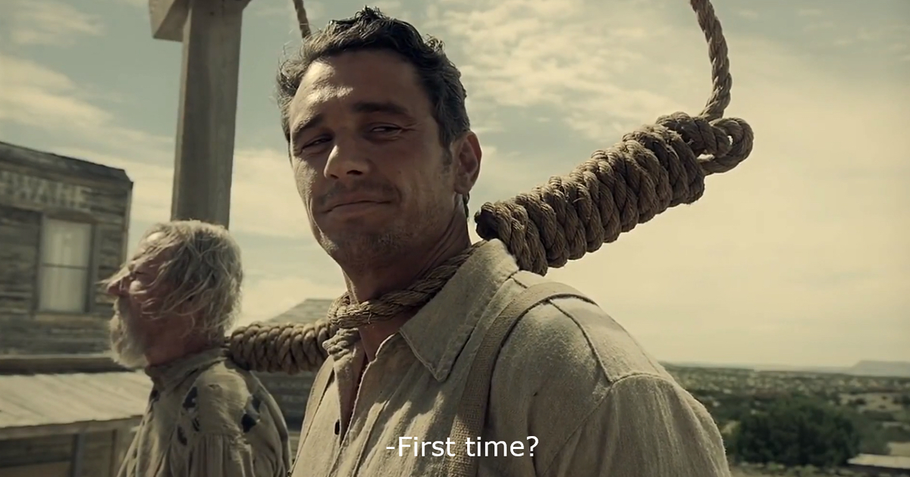
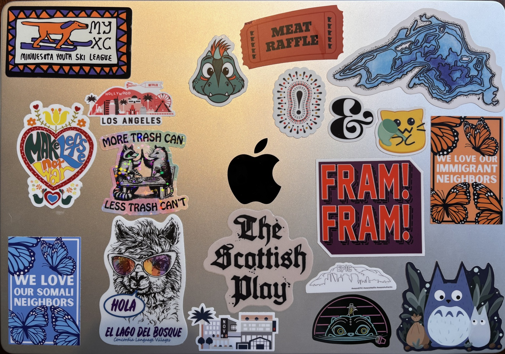

Last week there were rumors.

I remember talking about it with a coworker and feeling a creeping dread in my stomach. We agreed that the best we could do was make sure our résumés were current and to keep on as if we wouldn't be affected.

I remember enjoying an unusually warm October evening around a fire with friends, when Colin asked about the rumors. I said that I wasn't worried. From what I had seen, Netflix tried to be strategic about these things in the past --- and even though I had just joined in January, I had been doing good work on a critical project.

Wednesday morning, the emails started coming. Mass layoffs were the plan, ostensibly to keep the business strong and growing. I'm not sure how general layoffs achieve those goals, aside from cutting payroll and therefore pleasing shareholders and The Market.^[Number go up!] A few hours later, I was in a video meeting with a bunch of other folks, including a couple brilliant people I'd worked with. Our time at Netflix was done. I'm glad we had time to say good-bye to our now-former colleagues.

<figure>

<figcaption id="scruggs-caption">From <cite>The Ballad of Buster Scruggs</cite> --- streaming now! --- James Franco, soon to be hanged, says, “First time?”</figcaption>
</figure>

Layoffs are a weird thing. This isn't the first time I've been at a company that has done this kind of thing, but it was the first time I was on this end of the deal. They are rough for the people let go _and_ for the people who stay. When you stay, you get to deal with the emotional fallout of losing colleagues and with the prospect of having to do the same (or more) with less. When you go, you're left with something that is hard for our narrative-desiring brains to comprehend: at an individual level, there's not much you can do, but you can't help but feel like a failure.

Not long after receiving the news, I [posted on all the socials](https://bsky.app/profile/erikvorhes.bsky.social/post/3mxu5fxs3xk2d "this is the Bluesky skeet") a statement for myself and for anyone else going through this kind of thing:

> A reminder that if you get laid off, it’s not because you failed, it’s because leadership failed you.

Then after getting a few things tidied up, I also shared all the stickers on my work laptop:

* [Minnesota Youth Ski League](https://www.myxc.org)
* Rory the [Aurora](https://mnaurora.com)saurus
* a “meat raffle” ticket
* Lake Superior
* "make lefse, not war"
* one of the Netflix offices in Los Angeles, with the Hollywood sign
* a raccoon and an opossum, high-fiving each other, with the words, "More trash can, less trash can't"
* an exclamation point
* an ampersand
* an emoji cat with a net
* an orange one with butterflies that says, "We love our immigrant neighbors"
* one of the phrases from my [<i lang="la">alma mater</i>](https://wp.stolaf.edu), "Fram! Fram!" 'Onward! Onward!'
* a blue one with butterflies that says, "We love our Somali neighbors"
* a llama in sunglasses, saying "<i lang="es">Hola</i>," from [Concordia Language Villages](concordialanguagevillages.org)
* [the Scottish play](https://erikvorhes.com/has/macbeth/)
* one of the other Netflix offices in LA
* yet another of the Netflix offices in LA
* a neon version of Derpy and Sussie, stars of <cite>KPop Demon Hunters</cite> (on streaming now!)
* Totoro

I like loading up my laptops with stickers to make my metallic slab easily distinguishable from all the others.

## What's next?

> Always in motion is the future.^[Yoda is always up for a good sound-bite. When I was a kid I thought he said, "Always emotion is the future," which also works really well in this context!]

It's hard to say what's next. I've already started talking with a bunch of folks, but the beginning of the school year has been intense, so I'm almost grateful for this forced reset while I figure out the current state of serious job-hunting. 

I know I'd like to do good work for a generally non-evil organization. I'm still big on accessibility and building inclusively-designed interfaces. I love learning new things and contending with the constant change in the tech industry. Maybe I can work with _you_. I'm not the biggest fan of using [LinkedIn](https://www.linkedin.com/in/erikvorhes/), but feel free to reach out there.^[Let me know you read this, not to glaze me, but so I can be slightly less suspicious that you're a bot.]
